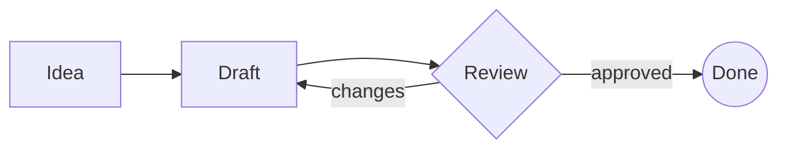

# Welcome

This editor is Vim on Markdown. Blocks render as you write; the block under the cursor
shows its raw text. `:set nopreview` shows it all raw. Notes save by themselves; `:w` saves now.

## Try

- Move with h j k l, w b e, gg G, f{char}, % and /search
- Change with d c y and a motion: dw, ci(, yap, then p or .
- [ ] i or a to type, <Esc> to stop; u undoes, Ctrl-R redoes
- [x] Tab indents in insert mode; in any other mode it leaves the editor

### Notes

- `:new Title` makes a note beside this one, `:sub Title` one under it
- `:e Title` opens a note; `:rename`, `:move Parent` (or `:move /`) and `:delete`
- `:nav` (or the ☰ button) goes to the notes tree: j k move, l h open and close, Enter opens, Esc goes back
- [[Ideas]] is a wiki link to a note that doesn't exist yet: click it to make it

### Links and code

See [the Nord palette](https://www.nordtheme.com) and `inline code`.

| Key | Does |
|-----|------|
| `zz` | centre the cursor line |
| `Ctrl-E` | scroll one row |

> [!tip] Links open in a new tab
> Click a rendered block to edit it.

### Maths

Inline $e^{i\pi} + 1 = 0$, while $5 and $10 stay prices.

$$
\sum_{k=1}^{n} k = \frac{n(n+1)}{2}
$$

### Diagrams

